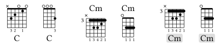
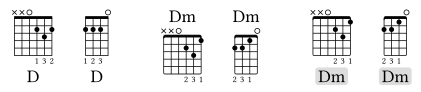
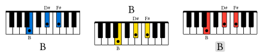
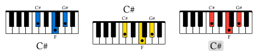
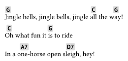
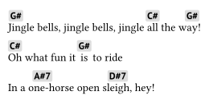
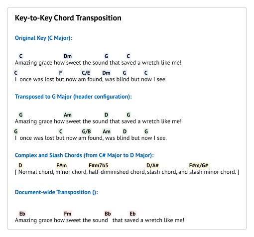
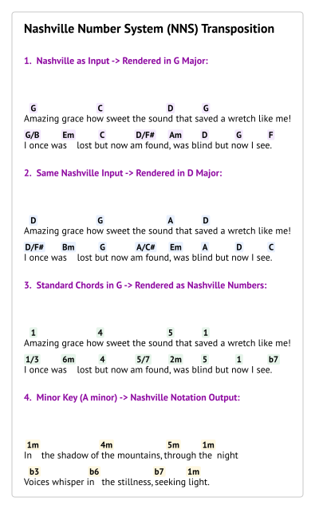

# chordx

A package to write song lyrics with chord diagrams in Typst.

**Table of Contents**

- [Introduction](#introduction)
- [Usage](#usage)
  - [Typst Packages](#typst-packages)
  - [Local Packages](#local-packages)
- [Documentation](#documentation)
- [Examples](#examples)
  - [Chart Chords](#chart-chords)
  - [Piano Chords](#piano-chords)
  - [Single Chords](#single-chords)
  - [Chord Transposition](#chord-transposition)
    - [Key-to-Key Transposition](#key-to-key-transposition)
    - [Nashville Number System](#nashville-number-system)
    - [Document-Wide Transposition](#document-wide-transposition)
- [Changelog](#changelog)
- [License](#license)

## Introduction

With `chordx` you can easily generate song lyrics with chords for writing songbooks.

`chordx` generates chord charts for stringed instruments (e.g. guitar, ukulele, etc.), piano chords (with diferent piano layouts) and single chords that are chords without charts used to write the chords over a word to write songbooks.

## Usage

`chordx` exports the following functions:

- `chart-chord`: used to generate chart chords for stringed instruments.
- `piano-chord`: used to generate piano chords.
- `single-chord`: used to show the chord name over a word with automatic transposition.
- `stanza-chord`: used to write full stanzas of lyrics with chords and transposition.
- `set-transpose`: used to configure chord transposition document-wide or within a scope.
- `transpose-chord`: utility function to transpose individual chord strings or content.

### Typst Packages

Typst added an experimental package repository and you can import `chordx` as follows:

```typ
#import "@preview/chordx:0.8.0": *
```

### Local Packages

If the package hasn't been released yet, or if you just want to use it from this repository, you can use _*local-packages*_.

You can read the documentation about typst [local-packages](https://github.com/typst/packages#local-packages) and learn about the path folders used in differents operating systems (Linux / MacOS / Windows).

In Linux you can do:

```sh
git clone https://github.com/ljgago/typst-chords ~/.local/share/typst/packages/local/chordx/0.8.0
```

And import the package in your file:

```typ
#import "@local/chordx:0.8.0": *
```

## Documentation

Here [chordx-docs](docs/chordx-docs.pdf) you have the reference documentation that describes the functions and parameters used in this package. (_Generated with [tidy](https://github.com/Mc-Zen/tidy)_)

## Examples:

### Chart Chords

```typ
#import "@preview/chordx:0.8.0": chart-chord

#let chart-chord-sharp = chart-chord.with(size: 18pt)
#let chart-chord-round = chart-chord.with(size: 1.5em, design: "round")

// Design "sharp"
#chart-chord-sharp(tabs: "x32o1o", fingers: "n32n1n")[C]
#chart-chord-sharp(tabs: "ooo3", fingers: "ooo3")[C]

// Desigh "round" with position "bottom"
#chart-chord-round(tabs: "xn332n", fingers: "o13421", fret: 3, capos: "115", position: "bottom")[Cm]
#chart-chord-round(tabs: "onnn", fingers: "n111", capos: "313", position: "bottom")[Cm]

// Design "round" with background color in chord name
#chart-chord-round(tabs: "xn332n", fingers: "o13421", fret: 3, capos: "115", background: silver)[Cm]
#chart-chord-round(tabs: "onnn", fingers: "n111", capos: "313", background: silver)[Cm]
```

<h3 align="center">
  <a href="examples/chart-chords.typ">
    
  </a>
</h3>

#### Chart Chords with manual transpose

Define different transposed chords and show only the chords with transpose = 2.

```typ
#import "@preview/chordx:0.8.0": chart-chord

#let transpose = 2

#let chart-chord-sharp-tr0 = chart-chord.with(
  size: 18pt,
  for-transpose: 0,
  show-transpose: transpose,
)
#let chart-chord-round-tr0 = chart-chord.with(
  design: "round",
  size: 1.5em,
  for-transpose: 0,
  show-transpose: transpose,
)

#let chart-chord-sharp-tr2 = chart-chord.with(
  size: 18pt,
  for-transpose: 2,
  show-transpose: transpose,
)
#let chart-chord-round-tr2 = chart-chord.with(
  design: "round",
  size: 1.5em,
  for-transpose: 2,
  show-transpose: transpose,
)

// Design "sharp"
#chart-chord-sharp-tr0(tabs: "x32o1o", fingers: "n32n1n")[C]
#chart-chord-sharp-tr2(tabs: "xxo232", fingers: "nnn132")[D]

#chart-chord-sharp-tr0(tabs: "ooo3", fingers: "ooo3")[C]
#chart-chord-sharp-tr2(tabs: "222o", fingers: "123o")[D]

// Desigh "round" with position "bottom"
#chart-chord-round-tr0(tabs: "xn332n", fingers: "o13421", fret: 3, capos: "115", position: "bottom")[Cm]
#chart-chord-round-tr2(tabs: "xxo231", fingers: "ooo231", position: "bottom")[Dm]

#chart-chord-round-tr0(tabs: "onnn", fingers: "n111", capos: "313", position: "bottom")[Cm]
#chart-chord-round-tr2(tabs: "221o", fingers: "231n", position: "bottom")[Dm]

// Design "round" with background color in chord name
#chart-chord-round-tr0(tabs: "xn332n", fingers: "o13421", fret: 3, capos: "115", background: silver)[Cm]
#chart-chord-round-tr2(tabs: "xxo231", fingers: "ooo231", background: silver)[Dm]

#chart-chord-round-tr0(tabs: "onnn", fingers: "n111", capos: "313", background: silver)[Cm]
#chart-chord-round-tr2(tabs: "221o", fingers: "231n", background: silver)[Dm]
```

<h3 align="center">
  <a href="examples/chart-chords-transpose.typ">
    
  </a>
</h3>

### Piano Chords

```typ
#import "@preview/chordx:0.8.0": piano-chord

#let piano-chord-sharp = piano-chord.with(layout: "F", size: 18pt)
#let piano-chord-round = piano-chord.with(layout: "F", size: 1.5em, design: "round")

#piano-chord-sharp(keys: "B1, D2#, F2#", fill-key: blue)[B]
#piano-chord-round(keys: "B1, D2#, F2#", fill-key: yellow, position: "bottom")[B]
#piano-chord-round(keys: "B1, D2#, F2#", fill-key: red)[B]
```

<h3 align="center">
  <a href="examples/piano-chords.typ">
    
  </a>
</h3>

#### Piano Chords with manual transpose

Define different transposed chords and show only the chords with transpose = 2.

```typ
#import "@preview/chordx:0.8.0": piano-chord

#let transpose = 2

#let piano-chord-sharp-tr0 = piano-chord.with(
  layout: "F",
  size: 18pt,
  for-transpose: 0,
  show-transpose: transpose,
)
#let piano-chord-round-tr0 = piano-chord.with(
  layout: "F",
  size: 1.5em,
  design: "round",
  for-transpose: 0,
  show-transpose: transpose,
)

#let piano-chord-sharp-tr2 = piano-chord.with(
  layout: "F",
  size: 18pt,
  for-transpose: 2,
  show-transpose: transpose,
)
#let piano-chord-round-tr2 = piano-chord.with(
  layout: "F",
  size: 1.5em,
  design: "round",
  for-transpose: 2,
  show-transpose: transpose,
)

#piano-chord-sharp-tr0(keys: "B1, D2#, F2#", fill-key: blue)[B]
#piano-chord-sharp-tr2(keys: "C2#, F2, G2#", fill-key: blue)[C\#]

#piano-chord-round-tr0(keys: "B1, D2#, F2#", fill-key: yellow, position: "bottom")[B]
#piano-chord-round-tr2(keys: "C2#, F2, G2#", fill-key: yellow, position: "bottom")[C\#]

#piano-chord-round-tr0(keys: "B1, D2#, F2#", fill-key: red, background: silver)[B]
#piano-chord-round-tr2(keys: "C2#, F2, G2#", fill-key: red, background: silver)[C\#]
```

<h3 align="center">
  <a href="examples/piano-chords-transpose.typ">
    
  </a>
</h3>

### Single Chords

```typ
#import "@preview/chordx:0.8.0": single-chord

#let chord = single-chord.with(
  font: "PT Sans",
  size: 12pt,
  inner-gap: 0.2em,
  outer-gap: 0.6em,
  weight: "semibold",
  background: silver,
)

#chord[Jingle][G][2] bells, jingle bells, jingle #chord[all][C][2] the #chord[way!][G][2] \
#chord[Oh][C][] what fun it #chord[is][G][] to ride \
In a #chord[one-horse][A7][2] open #chord[sleigh,][D7][3] hey!
```

<h3 align="center">
  <a href="examples/single-chords.typ">
    
  </a>
</h3>

#### Single Chords with automatic transpose

```typ
#import "@preview/chordx:0.8.0": single-chord

#let chord = single-chord.with(
  font: "PT Sans",
  size: 12pt,
  inner-gap: 0.2em,
  outer-gap: 0.6em,
  weight: "semibold",
  background: silver,
  accidental: "sharp",
  sharp-symbol: "#",
  transpose: 1,
)

#chord[Jingle][G][2] bells, jingle bells, jingle #chord[all][C][2] the #chord[way!][G][2] \
#chord[Oh][C][] what fun it #chord[is][G][] to ride \
In a #chord[one-horse][A7][2] open #chord[sleigh,][D7][3] hey!
```

<h3 align="center">
  <a href="examples/single-chords-transpose.typ">
    
  </a>
</h3>

### Chord Transposition

`chordx` supports comprehensive chord transposition between any keys (all 15 major keys and 15 minor keys), with full support for:
- **Normal chords**: `C`, `E`, `F`, etc.
- **Complex chords**: `C#`, `Dm`, `E#m`, `E#m7b5`, `Bbmaj7`, `Asus4`, `Gdim7`, etc.
- **Slash chords**: `C#/A`, `E#m/G`, `1/3`, `5/7`, etc.
- **Nashville Number System (NNS)**: both as input (`1`, `2m`, `4`, `5`, `6m`, `1/3`, `5/7`, `b7`) and as output.
- **Document-wide transposition**: set once with `#set-transpose(from: ..., to: ...)`.

#### Key-to-Key Transposition

Transpose a chord sheet between keys using `.with(from: ..., to: ...)`:

```typ
#import "@preview/chordx:0.8.0": stanza-chord

#let stanza = stanza-chord.with(
  font: "PT Sans",
  size: 11pt,
  weight: "semibold",
  background: silver,
  from: "C",
  to: "G",
)

#stanza("
 C               Dm              G       C
Amazing grace how sweet the sound that saved a wretch like me!
 C               F       C/E     Dm      G       C
I once was lost but now am found, was blind but now I see.
")
```

Complex chords and slash chords are transposed accurately:

```typ
#import "@preview/chordx:0.8.0": single-chord

#let chord = single-chord.with(from: "C#", to: "D")

// C# -> D, E#m -> F#m, E#m7b5 -> F#m7b5, C#/A -> F#/D, E#m/G -> F#m/G#
#chord[Normal][C#][1] chord,
#chord[minor][E#m][1] chord,
#chord[half-diminished][E#m7b5][1] chord,
#chord[slash][C#/A][1] chord, and
#chord[slash minor][E#m/G][1] chord.
```

<h3 align="center">
  <a href="examples/key-transpose.typ">
    
  </a>
</h3>

#### Nashville Number System

Use Nashville notation numbers (`1`..`7`, `1/3`, `6m`, `b7`, etc.) as input and render them in any target key:

```typ
#import "@preview/chordx:0.8.0": stanza-chord

// Write in Nashville notation, render in G major
#let stanza-in-g = stanza-chord.with(
  font: "PT Sans",
  size: 11pt,
  weight: "semibold",
  background: silver,
  from: "Nashville",
  to: "G",
)

#stanza-in-g("
 1               4               5       1
Amazing grace how sweet the sound that saved a wretch like me!
 1/3     6m      4       5/7     2m      5       1       b7
I once was lost but now am found, was blind but now I see.
")
```

Or convert standard chords into Nashville notation by specifying `to: "Nashville"`:

```typ
#let stanza-to-nash = stanza-chord.with(
  from: "G",
  to: "Nashville",
)
```

<h3 align="center">
  <a href="examples/nashville-notation.typ">
    
  </a>
</h3>

#### Document-Wide Transposition

Configure transposition globally across an entire document or book:

```typ
#import "@preview/chordx:0.8.0": set-transpose, stanza-chord

#set-transpose(from: "C", to: "Eb")

// All single-chord and stanza-chord calls automatically transpose from C to Eb
#stanza("
 C               Dm              G       C
Amazing grace how sweet the sound that saved a wretch like me!
")
```

## Changelog

You can read the latest changes in [CHANGELOG.md](./CHANGELOG.md)

## License
[MIT License](./LICENSE)
